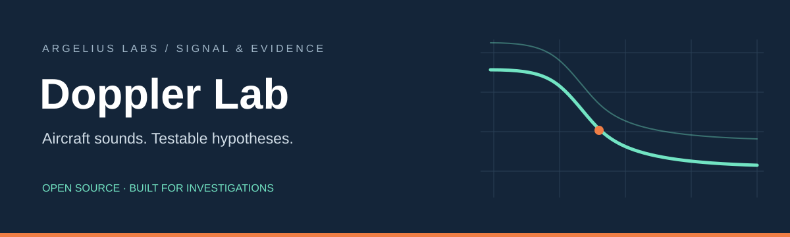
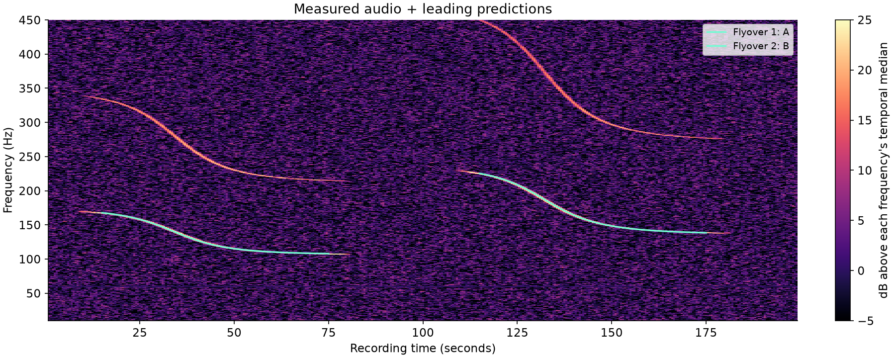

# Argelius Doppler Lab



**Turn aircraft sounds into testable location hypotheses. Learn when the evidence is insufficient.**

An open-source aircraft-audio investigation toolkit for OSINT practitioners, inspired by
[colsto's aircraft Doppler demonstration](https://www.youtube.com/watch?v=UytYrhYLOKI).
Original implementation by Argelius Labs. No affiliation with colsto is implied.

Acquire aircraft trajectories, screen flyover timing across a supported search area,
and compare candidate recorder locations against observed Doppler curves. Preserve the
recording clock, source hashes, assumptions and competing explanations in inspectable
reports. Generated practice data and optional teaching materials support learning the
investigation workflow.

**Status: experimental release — testing in progress.** Automated checks and real-data
archive/search benchmarks have passed. Original-recording field tests are still being
prepared; real-world location accuracy is not established. The solver reports hypotheses,
never an accepted location. Version 0.2.0 adds daily archive acquisition, regional
candidate screening and native downloads. It does not automatically identify aircraft
from audio.

**How do you start with only a country or continent?** Read the
[investigation workflow](docs/INVESTIGATION_WORKFLOW.md) for aircraft-data acquisition,
relative timing, broad candidate selection and local refinement. The
[download and storage guide](docs/DATA_VOLUME.md) gives verified archive sizes and
transfer estimates. The [real-data benchmark](docs/REAL_DATA_BENCHMARK.md) records actual
U.S., European and Tucson indexing/search measurements. These guides distinguish the
implemented workflow from the analysis and validation that still require an investigator.

**New here?** Start with the [native quick start](QUICKSTART.md), then the
[15–20 minute guided practice](docs/PRACTICE.md). Both run without installing Python.
For an investigation, use the [broad-area workflow](docs/BROAD_SEARCH.md).
Ordinary development pushes
produce test artifacts; publication requires an explicit release action.

## Build it with us

This is an early community project. Corrections, reproducible failures, practitioner
feedback and careful field validation are welcome. Start with the
[community roadmap](docs/ROADMAP.md) and [contribution guide](CONTRIBUTING.md).
Use [Issues](https://github.com/ArgeliusLabs/DopplerLab/issues) for bugs, proposals,
questions and shared experiments. Include unsuccessful experiments too.

[Download the experimental release](https://github.com/ArgeliusLabs/DopplerLab/releases)
for native Windows/Linux/macOS executables, the source ZIP, student pack, Python wheel
and checksums. Current native archives include the quick start and guided practice.

## Start in five minutes

Follow [QUICKSTART.md](QUICKSTART.md) to choose and extract your native download, then
open a terminal in the folder containing the executable. The example generates its
own fictional recording and aircraft tracks and runs offline.

Windows PowerShell:

```powershell
.\doppler-lab.exe demo --seed 7 --output practice/case
.\doppler-lab.exe run practice/case/case.json --output practice/report
Start-Process "practice/report/report.html"
```

macOS/Linux:

```bash
./doppler-lab demo --seed 7 --output practice/case
./doppler-lab run practice/case/case.json --output practice/report
# Open practice/report/report.html in your browser.
```

Use new output directories. The [guided practice](docs/PRACTICE.md) explains the report,
adds a noise-only comparison and provides a self-check after you record your assessment.
Keep `practice/case/truth.json` closed until that evaluation step.

## Install from source (optional)

For Python users and contributors, this route requires Python 3.11 or later.
Internet access is needed to install packages; the demo
runs offline afterward. FFmpeg is optional, needed only to decode non-WAV media.
Download a release or clone the repository:

```bash
git clone https://github.com/ArgeliusLabs/DopplerLab.git
cd DopplerLab
```

Then run from the repository directory:

Windows PowerShell (no activation or execution-policy change needed):

```powershell
python -m venv .venv
.\.venv\Scripts\python.exe -m pip install -e ".[dev]"
.\.venv\Scripts\doppler-lab.exe demo --output work\case
.\.venv\Scripts\doppler-lab.exe run work\case\case.json --output work\result
Start-Process work\result\report.html
```

macOS / Linux:

```bash
python3 -m venv .venv
.venv/bin/python -m pip install -e '.[dev]'
.venv/bin/doppler-lab demo --output work/case
.venv/bin/doppler-lab run work/case/case.json --output work/result
# Open work/result/report.html in your browser.
```

The generated case uses fictional local east/north/up coordinates, not a real person's
location. Keep `truth.json` closed until the evaluation step. Output directories must
be empty so previous experiments remain intact.



*Original fictional data. The mint lines are the leading model's predictions; this
demonstration does not establish real-world geolocation accuracy.*

For a no-install preview, open [the included report](examples/report/report.html).
GitHub displays HTML as source; download the student pack and open its report locally.
The [portable student pack guide](docs/STUDENT_PACK.md) describes the interpretation-only option.

## What is included

| Capability | Scope |
| --- | --- |
| Audio inspection | PCM WAV, explicit channel selection, anti-aliased resampling, spectrogram PNG |
| Media extraction | Local video/audio through FFmpeg, with explicit clip start and duration |
| Ideal flyby measurement | Fit a manually traced frequency ridge; report conditional speed/slant estimates |
| Physics | 3D trajectories, variable radial velocity, retarded sound arrival, one common clock |
| Matching | Small declared receiver grids, supplied candidate aircraft, per-event tone sweeps |
| Geographic import | WGS84 ellipsoid heights and explicit UTC to one local ENU frame |
| Daily archives | Verified downloads; stream compressed traces into a regional SQLite index |
| Broad screening | Spatially indexed, delayed-closest-approach pairs with a shared relative interval and explicit work budgets |
| Audio constraints | Filter existing candidates by separate speed/slant bounds for each flyover, with source hashes and retained alternatives |
| Local handoff | Export candidate tracks, coordinate origin and time basis for analyst-reviewed local matching |
| Evidence | Source hashes, full configuration, per-event scores, spatial alternatives, unsupported trials |
| Optional teaching materials | Student handout, instructor guide, answer key, rubric, extensions and a blind field protocol |

Start with [the investigation workflow](docs/INVESTIGATION_WORKFLOW.md),
[the public guide](docs/GUIDE.md), or [the research review](docs/RESEARCH.md).
For teaching, use [the student lab](docs/STUDENT_LAB.md).
For supplied recordings, read [data preparation](docs/DATA.md) before building a case.
See [validation](docs/VALIDATION.md) for measured results and their limits.

## The technique

For a stationary microphone and still, uniform air:

```text
arrival time = emission time + source-to-microphone distance / sound speed
heard frequency = source frequency / (1 + receding radial speed / sound speed)
```

Predict the **arrival-time** curve from each trajectory, compare it with spectral
energy in the recording, and use the same clock offset for all independent flyovers.
The second event cannot slide freely to make a bad location fit.
The [method document](docs/METHOD.md) gives equations, assumptions and implementation details.

## Before interpreting a match

Run controls, inspect each event, preserve competing locations, and validate with
independent evidence. A score is not a probability. Source pitch drift, wind, reflections,
bad heights, missing tracks, clock error and incomplete search bounds can all mislead.
Not seeing a tone is not proof that no aircraft passed.

Use recordings you own or have permission to study. Do not use the toolkit to expose private
people's locations. The supplied exercise is fictional and fully redistributable.

## Development

```powershell
.\.venv\Scripts\python.exe -m pytest
.\.venv\Scripts\ruff.exe check .
.\.venv\Scripts\python.exe scripts\benchmark.py --output work\benchmark
```

See [CONTRIBUTING.md](CONTRIBUTING.md). Code, original documentation and generated
fictional fixtures are MIT licensed. Third-party audio, video, flight databases and
terrain retain their own licenses; they are not bundled or relicensed by this project.

Related work: [DOPPLERGEIST](https://github.com/1337isnot1337/DOPPLERGEIST) is a separate,
broader experimental implementation. This repository emphasizes inspectable investigation
workflows, auditable candidate preparation and transparent reports. No source
code from that project was copied.
