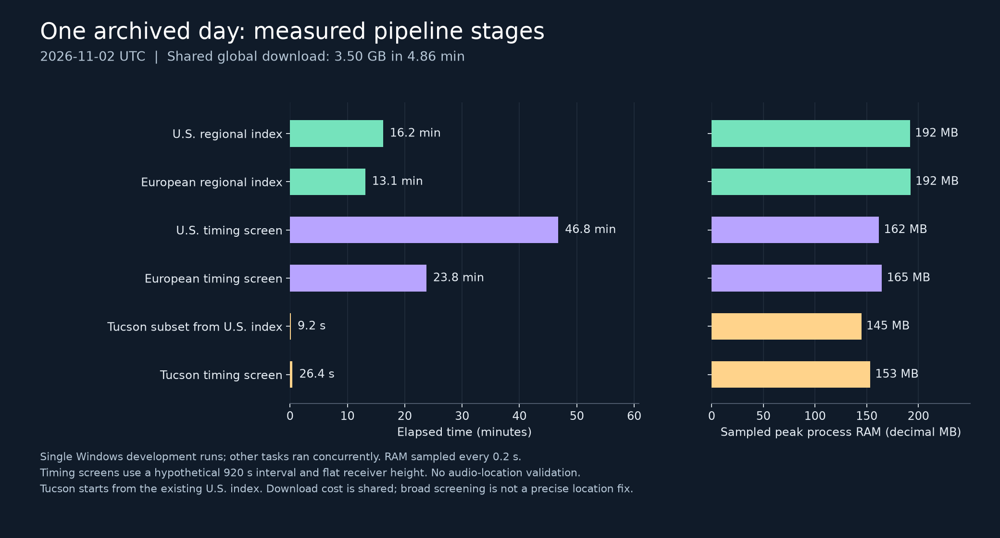

# Real-data download and search benchmark

Measured on **3 November 2026** using the complete **2 November 2026 UTC** production
archive from [adsb.lol](https://github.com/adsblol/globe_history_2026/releases/tag/v2026.11.02-planes-readsb-prod-0). The shared worldwide download was
**3.502 GB in 4 min 52 s**. We then completed both regional
indexes, both broad timing screens and a smaller Tucson refinement.

This answers how much data and processing the implemented workflow required for one
real archived day. **No original field recording was matched in this benchmark.**
The timing interval and receiver height were hypothetical; these results establish
processing feasibility, not location accuracy or complete aircraft coverage.

## Measured stages

| Stage | Elapsed wall time | Sampled peak process RAM | Retained output |
| --- | ---: | ---: | ---: |
| U.S. regional index | 16 min 14 s | 191.9 MB | 0.930 GB |
| European regional index | 13 min 07 s | 192.3 MB | 0.463 GB |
| U.S. coarse timing screen | 46 min 46 s | 161.8 MB | 13.889 GB |
| European coarse timing screen | 23 min 47 s | 164.8 MB | 3.619 GB |
| Tucson subset of existing U.S. index | 9.2 s | 144.8 MB | 0.026 GB |
| Tucson finer timing screen | 26.4 s | 153.4 MB | 0.027 GB |

GB and MB are decimal units. Output includes each stage's data files and manifest,
excluding the shared download and earlier stages. The index files themselves are
0.930 GB for the U.S. and 0.463 GB for Europe. These are compressed, quality-filtered
trajectory indexes, not exhaustive lists of regional flights.

Adding the separately measured download, index and broad-screen durations gives
**67 min 51 s for the U.S.** or **41 min 45 s for Europe**.
These sums are planning illustrations, not separately timed end-to-end runs. They stop
at candidate generation; audio analysis, terrain preparation and detailed matching add
work. The global archive is downloaded once and reused for both regions.



The complete counts, commands, source hashes, settings and machine details are in
[archive-benchmark.json](../examples/archive-benchmark.json). The figure is generated
from that file by [plot_archive_benchmark.py](https://github.com/ArgeliusLabs/DopplerLab/blob/main/scripts/plot_archive_benchmark.py).

## What was searched

Both large indexes covered `2026-11-02T00:00:00Z` through the exclusive end
`2026-11-03T00:00:00Z`, with 30 km spatial padding and a 30-second maximum trajectory
gap. The region presets are rectangles, not political boundaries:

- Contiguous U.S.: south 24, west -125, north 50, east -66 degrees.
- Europe: south 34, west -25, north 72, east 45 degrees.
- Tucson refinement: south 32.15, west -111.10, north 32.45, east -110.60 degrees.

Each global parse read **99,067,351 points in 57,246 supported full ICAO traces**.
The U.S. index retained **41,490,648 points in 166,858 segments**; Europe retained
**19,900,197 points in 81,084 segments**. Position source, geometric height, ground
status, time, region, stale samples and segment quality all affect retention. Missing
geometric height is not replaced by pressure altitude. Rejection counters are included
in the aggregate JSON; interpret them in the indexer's filter order.

The coarse screens used:

- Two distinct aircraft and a **hypothetical 920-second arrival-time interval**.
- 10-second measurement tolerance, plus the documented grid timing allowance.
- 10 km receiver spacing, nominal 10 km slant radius with cell allowance, and a single
  **0 m ellipsoid receiver height**. That height is a workload assumption, unsuitable
  as a real terrain model for these regions.
- Sound speed 343 m/s and broad trajectory speed bounds of 25–300 m/s.
- Explicit limits of 1 billion edge/receiver evaluations, 30 million passages and
  50 million output candidates. Defaults are smaller and would stop this workload.

The Tucson screen reused the U.S. index through `subset-index`, then used 1 km spacing
and the default work limits. Its other timing/radius/height assumptions were the same.
It retained 2,326 parent segments; subsetting preserves intersecting whole segments and
their boundary context rather than cutting tracks at the visible rectangle.

| Screen | Receiver nodes | Retained passages | Candidate rows |
| --- | ---: | ---: | ---: |
| U.S. | 151,704 | 15,530,376 | 48,657,675 |
| Europe | 196,074 | 8,677,954 | 11,446,891 |
| Tucson | 1,707 | 201,082 | 51,156 |

**A row is a receiver-cell/trajectory-pair alternative, not an independently verified
location or a probability.** The very large candidate counts demonstrate how weak a
time interval alone can be. A finer grid, measured speed/slant constraints, supported
clock evidence, terrain and competing local fits are needed to evaluate hypotheses.
An empty result also cannot rule out a location when coverage or assumptions excluded
the true flight.

As a separate function demonstration, hypothetical per-event speed/slant bounds reduced
the Tucson list from **51,156 to 1,121 rows** while preserving original candidate IDs.
The filter's internal loop took 0.246 seconds; this excludes CLI startup and input
hashing. Those bounds were not measured from audio and do not validate any retained row.

## Storage to reserve

| Retained successful run material | Total |
| --- | ---: |
| Shared global parts + U.S. index + U.S. screen | 18.321 GB |
| Shared global parts + European index + European screen | 7.584 GB |
| Shared global parts + both indexes + both screens | 22.403 GB |
| Add the Tucson subset and its screen | 0.053 GB additional |

These are retained-file totals, **not peak filesystem usage**. They exclude the virtual
environment, binaries, logs, failed experiments, filesystem overhead, audio, terrain,
temporary SQLite storage and additional investigations. Use the upper end of the
original **20–50 GB free workspace** planning range when retaining both large screens
and development experiments. Even 50 GB is not a ceiling for larger searches.

The archive held 63,445 trace members. Their gzip footer sizes sum to **17.632 GB** of
expanded trace JSON, with a largest decoded trace of **437.1 MB**. The supported ICAO
filename subset is smaller; other names include non-ICAO addresses prefixed with `~`.
The measured indexer streamed the split tar and compressed records directly. It did
not create a joined tar, extracted record tree or expanded JSON copy.

## Reproduce the workload

Use development version `0.2.0.dev1` or a compatible later version. The commands in
[BROAD_SEARCH.md](BROAD_SEARCH.md) explain installation, all source/geometry choices,
filtering, export and limits. Choose new output directories. For these exact large
screening settings, after creating each day's regional index:

```text
python -m pip install -e ".[benchmark]"
python scripts/measure_command.py --output work/us-measurement.json -- doppler-lab shortlist work/conus-index/index.sqlite --interval 920 --tolerance 10 --grid-km 10 --radius-km 10 --receiver-height 0 --max-evaluations 1000000000 --max-passages 30000000 --max-pairs 50000000 --output work/us-screen
python scripts/measure_command.py --output work/europe-measurement.json -- doppler-lab shortlist work/europe-index/index.sqlite --interval 920 --tolerance 10 --grid-km 10 --radius-km 10 --receiver-height 0 --max-evaluations 1000000000 --max-passages 30000000 --max-pairs 50000000 --output work/europe-screen
```

The aggregate JSON contains the exact commands used on Windows, including indexing
and Tucson subsetting. Adapt the executable path to your environment. The reporting
script [summarize_archive_benchmark.py](https://github.com/ArgeliusLabs/DopplerLab/blob/main/scripts/summarize_archive_benchmark.py) uses
the preserved local run names and refuses incomplete/nonzero-exit measurements. Raw
provider archives and generated trajectory databases are not bundled in this project.

## Measurement conditions and unsuccessful attempts

Windows 11 build 26200; Intel family 6/model 183 processor; 32 logical CPUs;
68,456,882,176 bytes system RAM (about 64 GiB). Python
3.13.11; numpy 2.5.4, scipy 1.18.1, matplotlib 3.11.2, ijson 3.6.0, certifi 2026.10.23, psutil 7.2.2. Package versions were recorded
when aggregating the results. Disk model and storage throughput were not characterized.

These are **single development runs**, with warm filesystem caches and overlapping
development/build/benchmark activity. They are not controlled repeated comparisons
or a hardware requirement. RSS is the process-tree resident memory sampled every
0.2 seconds; it can miss transient peaks and excludes the operating system's page cache.
The timing wrapper includes process startup and completion; stage-internal times in
manifests can be slightly shorter. Index measurements preceded final development
commits; screening measurements include the source commit and source-file hashes.

Two earlier attempts are preserved locally and excluded from the successful table:
the initial whole-record JSON reader stopped at its 64 MiB decoded-record limit; it
was replaced with streaming parsing. An initial U.S. screen was deliberately stopped
after 293 seconds when observed passage counts projected beyond its 10-million budget.
It was rerun with the explicit larger limits above. Neither partial output is treated
as a completed search.

The November 3 live-polling attempt also stopped at HTTP 429 after ten snapshots. It
is not a completed live capture. The completed benchmarks use **yesterday's archived
day**, not a recording collected today.

Two original recording cases are still pending before the next tagged release. See
[the validation record](https://github.com/ArgeliusLabs/DopplerLab/blob/main/docs/VALIDATION.md)
and the [field protocol](FIELD_PROTOCOL.md). Cross-day
event pairing, terrain-aware broad screening, unknown-date search and real-world
precision/false-localization rates are not established by these measurements.

Source data: [adsb.lol historical open data](https://www.adsb.lol/docs/open-data/historical),
under [ODbL 1.0](https://opendatacommons.org/licenses/odbl/1-0/). Aggregate benchmark
measurements and the figure were produced by Argelius Labs. The project's MIT code
license does not replace the provider's data terms.
